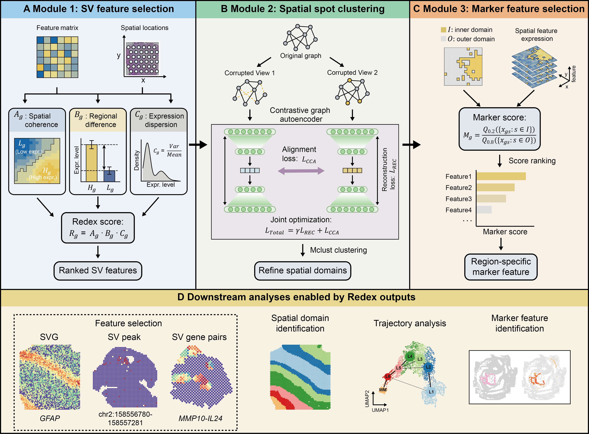

# Redex

Redex is a computational framework for spatially variable feature identification based on regional differential expression. It supports spatial omics analysis by connecting feature selection, spatial domain clustering, and marker feature discovery in one workflow.

The method was designed for spatially resolved molecular data where each observation has feature measurements and spatial coordinates. Redex can be applied to spatial transcriptomics, spatial ATAC-seq, and derived spatial feature matrices such as local gene-pair co-expression profiles.



## Workflow

Redex contains three main modules:

1. Spatially variable feature (SVF) selection: ranks genes, peaks, or derived features by combining spatial coherence, regional expression contrast, and global expression heterogeneity.
2. Spatial spot clustering: learns spatially informed embeddings with a graph attention network and self-supervised contrastive learning, then clusters spots into spatial domains.
3. Marker feature selection: identifies region-specific marker features by comparing within-domain and out-of-domain expression levels.

Common downstream analyses include spatial domain segmentation, UMAP visualization, PAGA trajectory analysis, ARI/NMI evaluation, marker feature detection, SV peak prioritization, and spatial gene-pair co-expression analysis.

## Installation

Clone the repository and create a Python environment:

```bash
git clone https://github.com/Wu-Lab/Redex.git
cd Redex
conda create -n redex python=3.8
conda activate redex
```

Install the optional R dependencies used by the default `mclust` clustering workflow:

```bash
conda install -c conda-forge r=4.1.0
conda install -c conda-forge r-mclust
```

Install PyTorch and DGL. The following commands install CUDA 11.8 builds:

```bash
pip install torch==2.3.1+cu118 torchvision==0.18.1+cu118 torchaudio==2.3.1+cu118 --index-url https://download.pytorch.org/whl/cu118
pip install dgl==1.1.2+cu118 -f https://data.dgl.ai/wheels/cu118/repo.html
```

Install the remaining Python dependencies and the editable local package:

```bash
pip install -r requirements.txt
pip install -e .
```

### Jupyter kernel

Install a notebook kernel for the environment:

```bash
pip install ipykernel
python -m ipykernel install --user --name redex --display-name redex
```

## Tutorial
For the step-by-step tutorial, please refer to: [Redex tutorial](https://redex-1.readthedocs.io/en/latest)

## Data

All tutorial data can be downloaded from Quark Cloud: [Link](https://pan.quark.cn/s/2f695d3f9e90)

After downloading, place the datasets under the repository root following the layouts described in the online tutorial notebooks.

## Citation

> *Redex: spatially variable feature identification based on regional differential expression*. 
<br />

## License ##
Redex is licensed under the GNU General Public License v3.0.

Improvements and new features of Redex will be updated on a regular basis. Please post on the [GitHub issues page](https://github.com/Wu-Lab/Redex/issues) with any questions.
